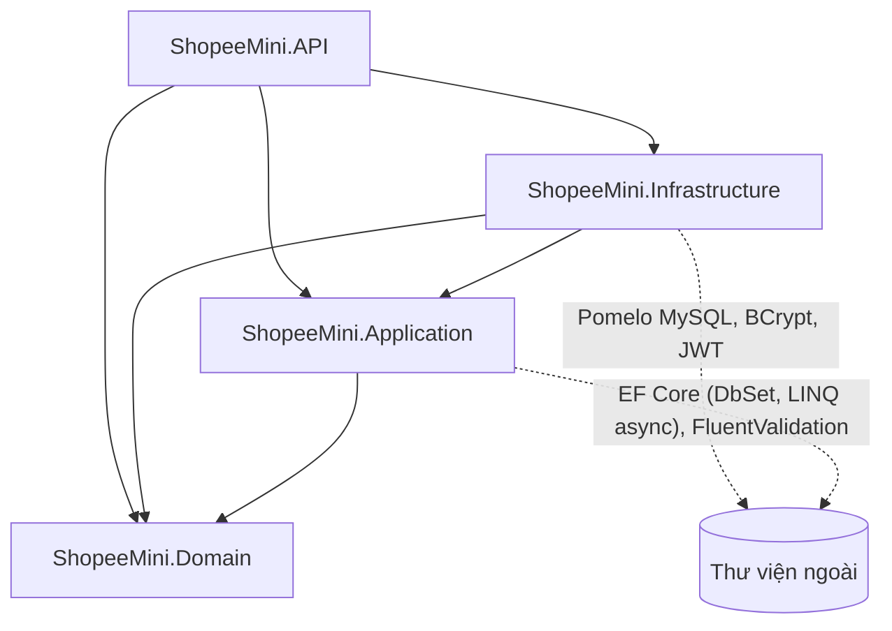
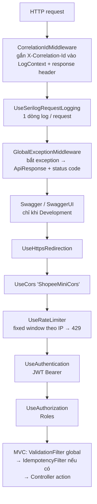
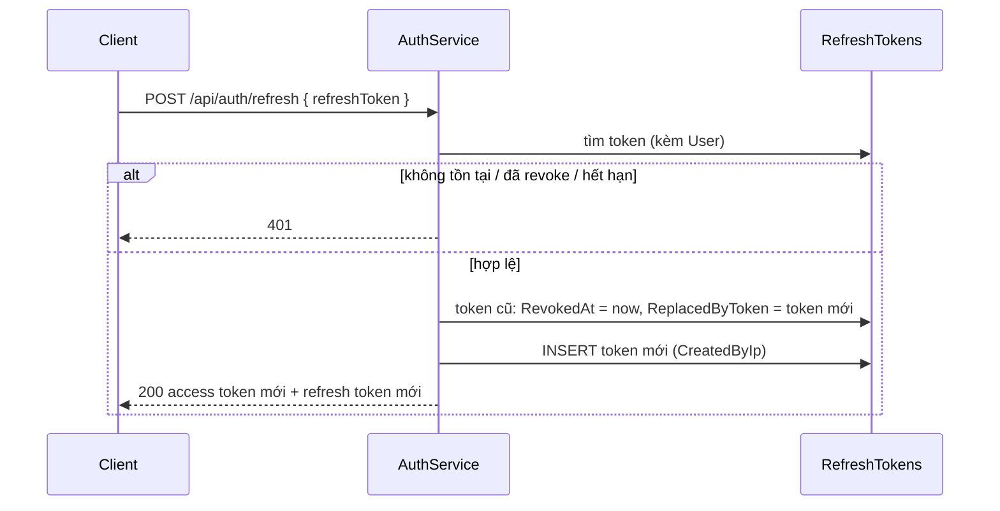
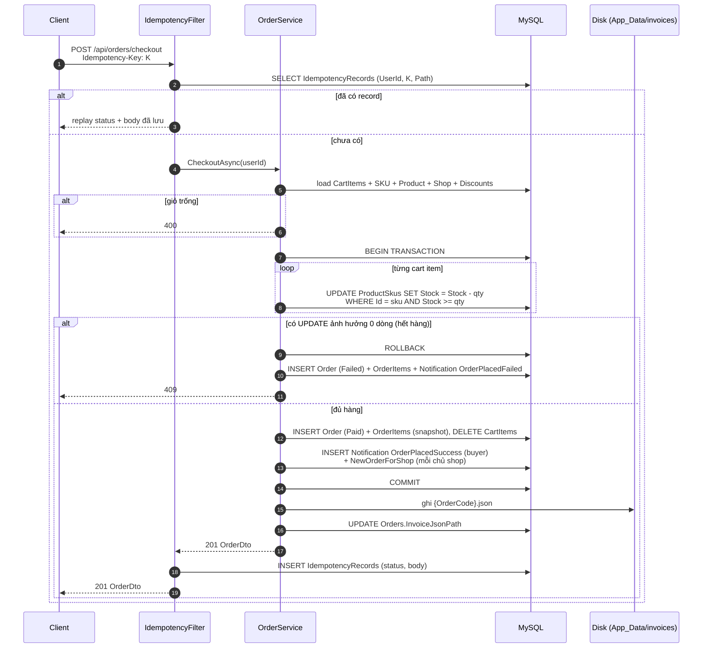

# Kiến trúc hệ thống — ShopeeMini Backend

Tài liệu mô tả kiến trúc backend ShopeeMini: cách chia tầng, luồng xử lý một request, các cơ chế xuyên suốt (xác thực, validate, xử lý lỗi, logging, idempotency, transaction) và các luồng nghiệp vụ quan trọng.

Tài liệu liên quan:
- [api-specification.md](api-specification.md): đặc tả chi tiết từng endpoint.
- [database-schema.md](database-schema.md): bảng, cột, index, quan hệ.
- [IDEMPOTENCY.md](IDEMPOTENCY.md), [LOG_LEVELS.md](LOG_LEVELS.md), [MIGRATIONS.md](MIGRATIONS.md): đi sâu từng chủ đề.

---

## 1. Tổng quan

ShopeeMini là backend REST API cho một sàn thương mại điện tử thu nhỏ với 2 vai trò:

| Vai trò | Làm được gì |
|---|---|
| **Admin** (chủ shop) | Quản lý danh mục, sản phẩm (SPU) và biến thể (SKU), tồn kho, giá, khuyến mãi theo SKU, ẩn/hiện sản phẩm, xem các dòng đơn hàng thuộc shop mình |
| **User** (người mua) | Xem sản phẩm, quản lý giỏ hàng, thanh toán, xem lịch sử đơn hàng |
| Cả hai | Đăng nhập, xem hồ sơ, đổi mật khẩu, nhận và quản lý thông báo |
| Khách (chưa đăng nhập) | Đăng ký, xem danh mục và sản phẩm đang public |

### 1.1. Công nghệ

| Thành phần | Công nghệ | Phiên bản |
|---|---|---|
| Runtime | .NET / ASP.NET Core | 8.0 |
| ORM | Entity Framework Core | 8.0.10 |
| Database provider | Pomelo.EntityFrameworkCore.MySql | 8.0.2 |
| Database | MySQL (Docker image `mysql:8.0`) | 8.0 |
| Validation | FluentValidation | 11.9.2 |
| Xác thực | JWT Bearer (`Microsoft.AspNetCore.Authentication.JwtBearer`, `System.IdentityModel.Tokens.Jwt`) | 8.0.x |
| Hash mật khẩu | BCrypt.Net-Next (Enhanced, work factor 12) | 4.0.3 |
| Logging | Serilog (Console + File sink, enricher Environment) | 8.0.3 |
| API docs | Swashbuckle (Swagger UI) | 6.6.2 |
| Rate limiting | `Microsoft.AspNetCore.RateLimiting` (built-in) | 8.0 |

---

## 2. Cấu trúc solution

Solution [ShopeeMini.slnx](../ShopeeMini.slnx) gồm 4 project theo Clean Architecture:

```
ShopeeMiniBackEnd/
├── ShopeeMini.Domain/            Entity, Enum. Không phụ thuộc gì.
│   ├── Common/BaseEntity.cs
│   ├── Entities/                 User, Shop, Category, Product, ProductSku, ProductDiscount,
│   │                             CartItem, Order, OrderItem, Notification, RefreshToken, IdempotencyRecord
│   └── Enums/Enums.cs            UserRole, OrderStatus, NotificationType, NotificationTargetRole
│
├── ShopeeMini.Application/       Use case (service), DTO, validator, interface hạ tầng
│   ├── Common/                   DiscountCalculator, IdempotencyService, Exceptions, Models (ApiResponse, PagedResult, JwtSettings)
│   ├── Features/                 Auth, Cart, Categories, Notifications, Orders, Products
│   │   └── <Feature>/            I<Feature>Service, <Feature>Service, Dtos/, Validators/
│   ├── Interfaces/               IAppDbContext, IJwtService, IPasswordHasher, IInvoiceJsonWriter,
│   │                             ICurrentUserService, IIdempotencyService
│   └── DependencyInjection.cs    AddApplication()
│
├── ShopeeMini.Infrastructure/    Hiện thực interface của Application
│   ├── Auth/                     JwtService, BCryptPasswordHasher
│   ├── Files/                    InvoiceJsonWriter
│   ├── Persistence/              AppDbContext, Configurations/, Migrations/, Seed/DbSeeder
│   └── DependencyInjection.cs    AddInfrastructure()
│
└── ShopeeMini.API/               Tầng HTTP (startup project)
    ├── Controllers/              9 file controller, 13 controller class
    ├── Filters/                  ValidationFilter, IdempotencyFilter
    ├── Middleware/               CorrelationIdMiddleware, GlobalExceptionMiddleware
    ├── Auth/                     CurrentUserService
    ├── Program.cs                Cấu hình DI + pipeline
    └── appsettings*.json
```

### 2.1. Sơ đồ phụ thuộc giữa các project



**Nguyên tắc Dependency Inversion:** Application định nghĩa interface (`IAppDbContext`, `IJwtService`, `IPasswordHasher`, `IInvoiceJsonWriter`...), Infrastructure hiện thực chúng. Application không biết MySQL, BCrypt hay ổ đĩa.

> **Lưu ý:** Application **có** tham chiếu package `Microsoft.EntityFrameworkCore` và `Microsoft.EntityFrameworkCore.Relational`, vì `IAppDbContext` để lộ `DbSet<T>` và `DatabaseFacade`, còn service dùng trực tiếp `Include`, `AsNoTracking`, `ExecuteUpdateAsync`, `EF.Functions.Like`, `BeginTransactionAsync`. Nói cách khác, Application độc lập với **provider** (MySQL), nhưng không độc lập với **EF Core**. Đây là đánh đổi có chủ đích để khỏi phải viết thêm tầng Repository.

---

## 3. Trách nhiệm từng tầng

### 3.1. Domain

- Chỉ chứa POCO entity và enum, không có attribute EF Core, không có logic truy cập dữ liệu.
- Mọi entity kế thừa [BaseEntity](../ShopeeMiniBackEnd/ShopeeMini.Domain/Common/BaseEntity.cs): `Id` (`long`), `CreatedAt`, `UpdatedAt` (UTC).
- Mô hình **SPU/SKU**: `Product` là SPU (vỏ gom nhóm, có tên, mô tả, danh mục, cờ `IsPublic`), `ProductSku` là SKU (biến thể cụ thể, có giá và tồn kho riêng). Khuyến mãi (`ProductDiscount`) gắn với từng SKU, có khoảng thời gian `StartAt`–`EndAt`. Không có giảm giá theo tổng đơn.
- `OrderItem` lưu **snapshot** (tên sản phẩm, tên biến thể, đơn giá, % giảm) tại thời điểm mua, nên sau này admin sửa catalog không làm thay đổi đơn cũ.
- `RefreshToken.IsActive` là thuộc tính tính toán (`RevokedAt is null && now < ExpiresAt`), không lưu xuống DB.

### 3.2. Application

Mỗi feature theo cùng một khuôn:

| Feature | Interface | Service | Ghi chú |
|---|---|---|---|
| Auth | `IAuthService` | `AuthService` | Đăng ký, đăng nhập, refresh, logout, hồ sơ, đổi mật khẩu |
| Categories | `ICategoryService` | `CategoryService` | CRUD danh mục (cây cha-con) |
| Products (public) | `IPublicCatalogService` | `PublicCatalogService` | Danh sách và chi tiết sản phẩm public |
| Products (admin) | `IAdminProductService` | `AdminProductService` | SPU, SKU, tồn kho, giá, khuyến mãi, ẩn/hiện |
| Cart | `ICartService` | `CartService` | Giỏ hàng, tính giá sau giảm |
| Orders (user) | `IOrderService` | `OrderService` | Checkout (transaction), lịch sử đơn |
| Orders (admin) | `IAdminOrderService` | `AdminOrderService` | Dòng đơn hàng theo shop |
| Notifications | `INotificationService` | `NotificationService` | Danh sách, đánh dấu đã đọc, xóa |
| Idempotency | `IIdempotencyService` | `IdempotencyService` | Đọc/ghi response đã cache |

Các thành phần dùng chung trong `Common/`:

- [DiscountCalculator](../ShopeeMiniBackEnd/ShopeeMini.Application/Common/DiscountCalculator.cs): chọn **% giảm lớn nhất** trong các khuyến mãi đang hiệu lực (`IsActive && StartAt <= now <= EndAt`), áp vào giá, làm tròn 2 chữ số (`MidpointRounding.AwayFromZero`).
- [AppExceptions](../ShopeeMiniBackEnd/ShopeeMini.Application/Common/Exceptions/AppExceptions.cs): exception nghiệp vụ, được middleware map sang HTTP status (mục 6).
- [ApiResponse](../ShopeeMiniBackEnd/ShopeeMini.Application/Common/Models/ApiResponse.cs), [PagedResult / PaginationQuery](../ShopeeMiniBackEnd/ShopeeMini.Application/Common/Models/PagedResult.cs): envelope response và phân trang.

Service nhận `userId` từ controller (lấy từ JWT), **không** tự đọc `HttpContext`. Kiểm tra quyền sở hữu (sản phẩm/SKU/khuyến mãi thuộc shop của admin, cart item/đơn/thông báo thuộc user) nằm trong service.

### 3.3. Infrastructure

| Thành phần | Hiện thực | Ghi chú |
|---|---|---|
| `AppDbContext` | `IAppDbContext` | Tự gán `CreatedAt`/`UpdatedAt` trong `SaveChangesAsync`; nạp mọi `IEntityTypeConfiguration` trong assembly |
| `Configurations/*.cs` | Fluent API | Tên bảng, độ dài cột, precision, index, quan hệ, delete behavior. Chi tiết ở [database-schema.md](database-schema.md) |
| `JwtService` | `IJwtService` | Access token HS256; refresh token = 64 byte ngẫu nhiên (Base64) |
| `BCryptPasswordHasher` | `IPasswordHasher` | `EnhancedHashPassword`, work factor 12 |
| `InvoiceJsonWriter` | `IInvoiceJsonWriter` | Ghi `{InvoiceStorage:Directory}/{OrderCode}.json` |
| `DbSeeder` | — | Chạy migration, seed admin + shop + 4 danh mục |

`MySqlServerVersion` được cố định là `8.0.36` để EF Core không phải mở kết nối dò phiên bản lúc khởi động (và để `dotnet ef migrations add` chạy được khi không có MySQL).

### 3.4. API

- Mọi controller kế thừa [ApiControllerBase](../ShopeeMiniBackEnd/ShopeeMini.API/Controllers/ApiControllerBase.cs) (`[ApiController]`), có sẵn `CurrentUserId` và helper `SuccessResponse(...)` bọc dữ liệu vào `ApiResponse<T>`.
- Controller rất mỏng: nhận DTO, gọi service, trả `SuccessResponse`. Không có `try/catch`, không có if/else validate.
- Phân quyền bằng attribute: `[AllowAnonymous]`, `[Authorize]`, `[Authorize(Roles = "Admin")]`, `[Authorize(Roles = "User")]`.

| File | Controller class | Route gốc | Quyền |
|---|---|---|---|
| AuthController.cs | `AuthController` | `api/auth` | Anonymous |
| UsersController.cs | `UsersController` | `api/users` | Đã đăng nhập |
| CategoriesController.cs | `CategoriesController` | `api/categories` | Anonymous |
| | `AdminCategoriesController` | `api/admin/categories` | Admin |
| ProductsController.cs | `ProductsController` | `api/products` | Anonymous |
| AdminProductsController.cs | `AdminProductsController` | `api/admin/products` | Admin |
| | `AdminDiscountsController` | `api/admin/discounts` | Admin |
| CartController.cs | `CartController` | `api/cart` | User |
| OrdersController.cs | `OrdersController` | `api/orders` | User |
| | `AdminOrdersController` | `api/admin/orders` | Admin |
| NotificationsController.cs | `NotificationsController` | `api/notifications` | Đã đăng nhập |

---

## 4. Vòng đời một request

### 4.1. Middleware pipeline

Thứ tự đăng ký trong [Program.cs](../ShopeeMiniBackEnd/ShopeeMini.API/Program.cs):



Vì `GlobalExceptionMiddleware` đứng **trước** rate limiter và authentication, nó bắt được mọi exception phát sinh từ filter, controller và service. Các response do chính framework tạo (401/403 của JWT, 429 của rate limiter, 400 do model binding) **không** đi qua exception nên không có cùng format; xem [api-specification.md mục 1.6](api-specification.md#16-các-response-không-theo-envelope).

### 4.2. Action filters

| Filter | Phạm vi | Vai trò |
|---|---|---|
| [ValidationFilter](../ShopeeMiniBackEnd/ShopeeMini.API/Filters/ValidationFilter.cs) | Global (`options.Filters.Add<ValidationFilter>()`) | Với mỗi action argument, tìm `IValidator<T>` trong DI; nếu có thì validate, sai thì ném `FluentValidation.ValidationException` (→ 400 kèm `errors`) |
| [IdempotencyFilter](../ShopeeMiniBackEnd/ShopeeMini.API/Filters/IdempotencyFilter.cs) | Chỉ `POST /api/orders/checkout` (`[ServiceFilter]`) | Bắt buộc header `Idempotency-Key`; replay response đã lưu nếu trùng `(UserId, Key, Path)`; chỉ lưu response 2xx |

Validator được đăng ký tự động bằng `AddValidatorsFromAssembly` trong `AddApplication()`.

---

## 5. Xác thực và phân quyền

### 5.1. Token

| Token | Định dạng | Thời hạn (mặc định) | Lưu ở đâu |
|---|---|---|---|
| Access token | JWT HS256, ký bằng `Jwt:SigningKey` (chuỗi **Base64**) | `Jwt:AccessTokenMinutes` = 15 phút | Không lưu server-side |
| Refresh token | 64 byte ngẫu nhiên, Base64 (88 ký tự) | `Jwt:RefreshTokenDays` = 7 ngày | Bảng `RefreshTokens` |

Claims trong access token: `sub` (user id), `email`, `ClaimTypes.Name` (họ tên), `ClaimTypes.Role` (`Admin`/`User`), `jti`.

Kiểm tra token: issuer, audience, chữ ký, thời hạn, `ClockSkew` = 30 giây. JwtBearer map `sub` sang `ClaimTypes.NameIdentifier`, nên [CurrentUserService](../ShopeeMiniBackEnd/ShopeeMini.API/Auth/CurrentUserService.cs) và `IdempotencyFilter` đọc user id qua `NameIdentifier` (có fallback `sub`).

### 5.2. Luồng refresh token (rotation)



Logout chỉ đặt `RevokedAt` cho refresh token được gửi lên. Access token đã cấp vẫn dùng được tới khi hết hạn (không có blacklist).

### 5.3. Phân quyền

Hai lớp:

1. **Theo vai trò** (attribute trên controller): ví dụ Admin gọi `/api/cart` nhận 403, User gọi `/api/admin/*` nhận 403.
2. **Theo quyền sở hữu** (trong service):
   - Admin chỉ thao tác được sản phẩm/SKU/khuyến mãi thuộc **shop của mình** (`Shop.OwnerUserId == currentUserId`), sai thì `ForbiddenException` (403).
   - User chỉ thấy cart item, đơn hàng, thông báo của chính mình. Truy cập bản ghi của người khác trả **404** (lọc `UserId` ngay trong câu query, không để lộ sự tồn tại của bản ghi).

Mỗi admin có tối đa 1 shop (unique index `Shops.OwnerUserId`). Nếu admin chưa có shop, `AdminProductService.GetOrCreateShopAsync` tự tạo shop tên `"{FullName}'s Shop"` ở lần gọi đầu tiên.

---

## 6. Response chuẩn và xử lý lỗi

Mọi response do controller hoặc `GlobalExceptionMiddleware` tạo ra đều có dạng:

```json
{ "success": true, "data": { }, "message": "Thao tác thành công", "errors": null }
```

[GlobalExceptionMiddleware](../ShopeeMiniBackEnd/ShopeeMini.API/Middleware/GlobalExceptionMiddleware.cs) map exception:

| Exception | HTTP | `errors` | Mức log |
|---|---|---|---|
| `FluentValidation.ValidationException` | 400 | `{ "<PropertyName>": ["..."] }` | Warning |
| `ValidationAppException` | 400 | dictionary lỗi | Warning |
| `BadRequestException` | 400 | null | Warning |
| `UnauthorizedAppException` | 401 | null | Warning |
| `ForbiddenException` | 403 | null | Warning |
| `NotFoundException` | 404 | null | Warning |
| `ConflictException` | 409 | null | Warning |
| Mọi exception khác | 500 | null, message chung chung (ẩn chi tiết) | Error + stack trace |

Service chỉ cần `throw`, không tự tạo response lỗi.

---

## 7. Các luồng nghiệp vụ chính

### 7.1. Checkout (transaction + atomic update + idempotency)

Đây là luồng quan trọng nhất, nằm ở [OrderService.CheckoutAsync](../ShopeeMiniBackEnd/ShopeeMini.Application/Features/Orders/OrderService.cs).



Các điểm thiết kế:

- **Chống bán vượt tồn kho (oversell):** mỗi lần trừ kho là **một câu `UPDATE` có điều kiện** (`ExecuteUpdateAsync`). InnoDB khóa dòng trong lúc chạy, nên 2 checkout tranh nhau chiếc cuối cùng sẽ được tuần tự hóa. Request đến sau thấy `StockQuantity < qty`, `UPDATE` ảnh hưởng 0 dòng, và cả transaction bị rollback.
- **Atomicity:** hết hàng ở bất kỳ SKU nào thì mọi lần trừ kho trước đó trong vòng lặp đều được rollback.
- **Đơn thất bại vẫn được lưu:** sau rollback, hệ thống ghi một `Order` trạng thái `Failed` (`TotalAmount = 0`, `LineTotal = 0`) cùng thông báo cho user. Giỏ hàng **giữ nguyên** để user sửa lại.
- **Giá:** tính tại thời điểm checkout bằng `DiscountCalculator` (không dùng giá cache ở giỏ). `LineTotal = round(Price × (1 − %/100), 2) × Quantity`.
- **Ghi file sau commit:** I/O đĩa không rollback được, nên hóa đơn JSON chỉ ghi khi dữ liệu đã commit. Nếu ghi file lỗi, đơn hàng vẫn tồn tại nhưng `InvoiceJsonPath` là `null` và client nhận 500.
- **Idempotency:** retry với cùng `Idempotency-Key` sẽ nhận lại đúng response lần đầu, không trừ kho lần hai. Chi tiết và giới hạn ở [IDEMPOTENCY.md](IDEMPOTENCY.md).
- Endpoint `POST /api/orders/checkout-no-idempotency` chạy cùng logic nhưng **không** có `IdempotencyFilter`. Endpoint này chỉ để demo hậu quả khi thiếu idempotency, không dùng cho client thật.

Hiện chưa có tích hợp cổng thanh toán: đơn thành công được tạo thẳng với trạng thái `Paid`. Hai giá trị `Pending` và `Cancelled` của `OrderStatus` đã khai báo nhưng chưa có luồng nào dùng.

### 7.2. Ẩn sản phẩm

`AdminProductService.SetProductStatusAsync` (`PUT /api/admin/products/{id}/status`):

1. Nếu trạng thái không đổi thì return ngay.
2. Mở transaction.
3. Khi **ẩn** (`isPublic = false`): xóa mọi `CartItem` đang chứa SKU của sản phẩm (của mọi user) và tạo 1 thông báo `ProductHiddenRemovedFromCart` cho mỗi user bị ảnh hưởng.
4. `SaveChanges` rồi `Commit`. Xóa giỏ và gửi thông báo cùng thành công hoặc cùng thất bại.

Sản phẩm mới tạo luôn có `IsPublic = false`; admin phải bật hiển thị thì user mới thấy và mua được.

### 7.3. Tính giá hiển thị

| Nơi tính | Cách tính | Làm tròn |
|---|---|---|
| Chi tiết sản phẩm, giỏ hàng, response SKU của admin, checkout | `DiscountCalculator` trong bộ nhớ | 2 chữ số, `AwayFromZero` |
| Danh sách sản phẩm (public và admin) | Biểu thức LINQ dịch sang SQL (`MIN`/`MAX` + subquery `MAX(DiscountPercent)`) | Do MySQL tính, không làm tròn ở app |

Nếu một SKU có nhiều khuyến mãi chồng thời gian, hệ thống lấy **% lớn nhất** (không cộng dồn).

### 7.4. Thông báo

Thông báo được tạo **đồng bộ, trong cùng DB transaction** với nghiệp vụ sinh ra nó. Không có push/websocket, client phải polling `GET /api/notifications`.

| Loại | Người nhận | Khi nào | `RelatedEntityId` |
|---|---|---|---|
| `OrderPlacedSuccess` | Người mua | Checkout thành công | `Order.Id` |
| `OrderPlacedFailed` | Người mua | Checkout thất bại vì hết hàng | `Order.Id` (đơn Failed) |
| `NewOrderForShop` | Chủ mỗi shop có hàng trong đơn | Checkout thành công | `Order.Id` |
| `ProductHiddenRemovedFromCart` | User có SKU bị xóa khỏi giỏ | Admin ẩn sản phẩm | `Product.Id` |

---

## 8. Dependency Injection

| Service | Lifetime | Đăng ký ở |
|---|---|---|
| `AppDbContext`, `IAppDbContext` (cùng instance) | Scoped | Infrastructure |
| `IJwtService` → `JwtService` | Singleton | Infrastructure |
| `IPasswordHasher` → `BCryptPasswordHasher` | Singleton | Infrastructure |
| `IInvoiceJsonWriter` → `InvoiceJsonWriter` | Singleton | Infrastructure |
| `IOptions<JwtSettings>` | Singleton | Infrastructure (`Configure<JwtSettings>`) |
| Mọi feature service + `IIdempotencyService` | Scoped | Application |
| Mọi `IValidator<T>` | Scoped (mặc định của `AddValidatorsFromAssembly`) | Application |
| `ICurrentUserService` → `CurrentUserService` | Scoped | API |
| `ValidationFilter`, `IdempotencyFilter` | Scoped | API |

Mọi service trong một request dùng chung một `AppDbContext`, nên `IdempotencyService` và `OrderService` nằm trên cùng change tracker.

---

## 9. Logging và quan sát

- **Serilog** cấu hình trong `Program.cs`: mức tối thiểu `Information`; `Microsoft.AspNetCore` và `Microsoft.EntityFrameworkCore` hạ xuống `Warning`.
- Sink: Console (`[HH:mm:ss LVL] [CorrelationId] SourceContext: Message`) và File (`Serilog:FilePath`, mặc định `Logs/log-.txt`, cuộn theo ngày, giữ 14 file).
- Enricher: `FromLogContext`, `MachineName`, `EnvironmentName`.
- **Correlation ID:** `CorrelationIdMiddleware` lấy header `X-Correlation-Id` từ client (nếu có) hoặc sinh GUID mới, trả lại trong response header và đẩy vào `LogContext`. Mọi dòng log của request đó mang cùng ID.
- `UseSerilogRequestLogging()` ghi 1 dòng tóm tắt cho mỗi request (method, path, status, thời gian).
- Mức log là **hard-code** trong `Program.cs`; các khóa `Serilog:MinimumLevel` và `Logging:LogLevel` trong `appsettings.json` hiện không có tác dụng. Xem [LOG_LEVELS.md](LOG_LEVELS.md).

---

## 10. Cấu hình

File [appsettings.json](../ShopeeMiniBackEnd/ShopeeMini.API/appsettings.json):

| Khóa | Mặc định | Dùng ở |
|---|---|---|
| `ConnectionStrings:Default` | `Server=localhost;Port=3306;Database=shopee_mini;User=root;...;TreatTinyAsBoolean=true;` | `AddInfrastructure` (bắt buộc, thiếu thì app không khởi động) |
| `Jwt:Issuer` / `Jwt:Audience` | `ShopeeMini` / `ShopeeMiniClient` | Sinh và kiểm tra JWT |
| `Jwt:SigningKey` | chuỗi Base64 | Khóa HMAC-SHA256 (bắt buộc là Base64 hợp lệ) |
| `Jwt:AccessTokenMinutes` | 15 | `JwtService` |
| `Jwt:RefreshTokenDays` | 7 | `AuthService` |
| `InvoiceStorage:Directory` | `App_Data/invoices` | `InvoiceJsonWriter` (tạo thư mục lúc khởi tạo) |
| `Cors:AllowedOrigins` | `http://localhost:3000`, `http://localhost:5173` | Policy `ShopeeMiniCors` (cho phép credentials). Mảng rỗng thì `AllowAnyOrigin` |
| `RateLimiting:PermitLimit` | 100 | Số request / cửa sổ / IP |
| `RateLimiting:WindowSeconds` | 60 | Độ dài cửa sổ |
| `RateLimiting:QueueLimit` | 0 | Số request được xếp hàng khi vượt hạn mức |
| `Serilog:FilePath` | `Logs/log-.txt` | File sink |

Cổng chạy local (theo [launchSettings.json](../ShopeeMiniBackEnd/ShopeeMini.API/Properties/launchSettings.json)): `http://localhost:5019` và `https://localhost:7031`. Swagger UI ở `/swagger`, chỉ bật khi `ASPNETCORE_ENVIRONMENT=Development`.

> Connection string và `Jwt:SigningKey` đang nằm trong `appsettings.json`. Khi deploy thật nên đưa sang biến môi trường hoặc secret store.

---

## 11. Khởi động ứng dụng

Trước khi nhận request, `Program.cs` tạo một scope và gọi [DbSeeder.SeedAsync](../ShopeeMiniBackEnd/ShopeeMini.Infrastructure/Persistence/Seed/DbSeeder.cs):

1. `Database.MigrateAsync()`: áp dụng mọi migration chưa chạy (nên không bắt buộc chạy `dotnet ef database update` thủ công).
2. Nếu chưa có user nào role `Admin`: tạo `admin@shopeemini.local` / `Admin@123` và shop `ShopeeMini Official Store`.
3. Nếu bảng `Categories` trống: tạo 4 danh mục gốc.

Hạ tầng local: [docker-compose.yml](../docker-compose.yml) chạy container `shopeemini-mysql` (MySQL 8.0, database `shopee_mini`, cổng 3306, volume `shopeemini-mysql-data`).

---

## 12. Lưu trữ file

Hóa đơn JSON là bản export chỉ đọc; **database mới là nguồn dữ liệu gốc**.

- Đường dẫn: `{InvoiceStorage:Directory}/{OrderCode}.json`, tương đối so với thư mục làm việc của process. Giá trị lưu trong `Orders.InvoiceJsonPath` được tạo bằng `Path.Combine`, nên trên Windows có dạng `App_Data/invoices\ORD....json`.
- Nội dung: `OrderCode`, `UserId`, `TotalAmount`, `Status`, `CreatedAt`, `Items[]` (`ProductSkuId`, `ProductNameSnapshot`, `VariantNameSnapshot`, `UnitPrice`, `DiscountPercentApplied`, `Quantity`, `LineTotal`). Key viết PascalCase, có thụt lề.
- Chỉ đơn `Paid` mới có file; đơn `Failed` không ghi file.
- Hiện chưa có endpoint tải file hóa đơn; API chỉ trả đường dẫn.

---

## 13. Giới hạn đã biết

Các điểm sau đúng với code hiện tại, nên biết khi phát triển tiếp:

| # | Vấn đề | Ảnh hưởng |
|---|---|---|
| 1 | Trùng `SkuCode` (unique) khi tạo sản phẩm/SKU, hoặc trùng email khi 2 request đăng ký chạy song song, gây `DbUpdateException` không được bắt | Trả 500 thay vì 409 |
| 2 | Cập nhật danh mục không kiểm tra `ParentCategoryId` có tồn tại hay không, và không chặn tự tham chiếu hoặc vòng lặp | FK sai thì 500; có thể tạo cây danh mục vòng |
| 3 | Xóa danh mục còn danh mục con: FK `Restrict` chặn | 500 thay vì 409 |
| 4 | Thêm vào giỏ / sửa số lượng không kiểm tra tồn kho; sửa số lượng không kiểm tra sản phẩm còn public | Lỗi chỉ lộ ra khi checkout (409) |
| 5 | Refresh token không kiểm tra `User.IsActive` và không phát hiện tái sử dụng token đã rotate | User bị khóa vẫn refresh được token |
| 6 | `GET /api/admin/products` và `GET /api/admin/discounts` có thể **tạo shop** nếu admin chưa có | GET có side effect |
| 7 | Idempotency: check rồi mới lưu, không giữ chỗ key trước; 2 request cùng key đến đồng thời vẫn có thể cùng chạy | Xem [IDEMPOTENCY.md mục 9](IDEMPOTENCY.md) |
| 8 | Rate limiter in-memory theo IP; file hóa đơn trên đĩa cục bộ | Không dùng chung được khi scale ra nhiều instance |
| 9 | Bảng `IdempotencyRecords`, `RefreshTokens` chỉ tăng, không có job dọn dẹp | Dữ liệu phình dần |
| 10 | Checkout trừ kho bằng N câu `UPDATE` tuần tự (mỗi SKU một round-trip) | Độ trễ tăng tuyến tính theo số dòng trong giỏ |
| 11 | Enum `NotificationTargetRole` và trạng thái `Pending`/`Cancelled` chưa được dùng | Chưa có luồng hủy đơn hoặc thanh toán chờ |
