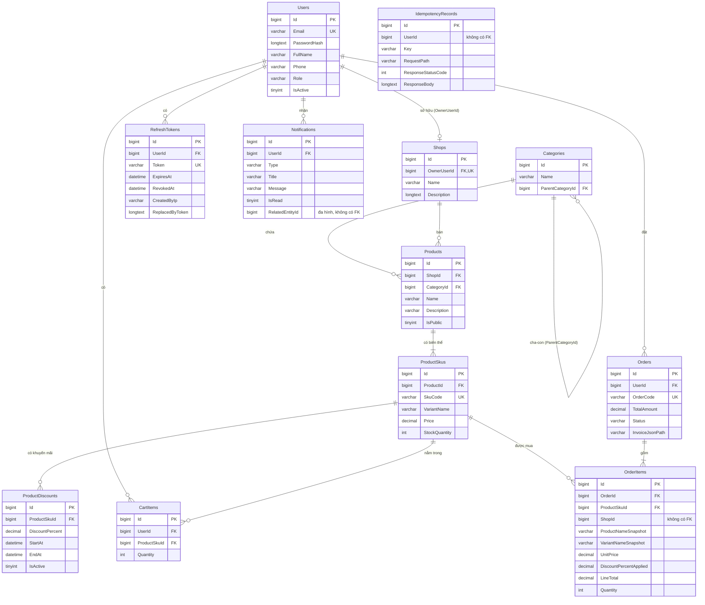

# Database Schema — ShopeeMini Backend

Mô tả cấu trúc cơ sở dữ liệu MySQL của ShopeeMini, viết từ entity trong `ShopeeMini.Domain`, cấu hình Fluent API trong [Persistence/Configurations](../ShopeeMiniBackEnd/ShopeeMini.Infrastructure/Persistence/Configurations/) và migration [20260930032604_InitialCreate](../ShopeeMiniBackEnd/ShopeeMini.Infrastructure/Persistence/Migrations/20260930032604_InitialCreate.cs).

Tài liệu liên quan: [architecture.md](architecture.md), [api-specification.md](api-specification.md), [MIGRATIONS.md](MIGRATIONS.md).

---

## 1. Tổng quan

| Thuộc tính | Giá trị |
|---|---|
| DBMS | MySQL 8.0 (EF Core cấu hình `MySqlServerVersion(8, 0, 36)`) |
| Provider | Pomelo.EntityFrameworkCore.MySql 8.0.2 |
| Database | `shopee_mini` |
| Charset | `utf8mb4` (collation mặc định của server, với `mysql:8.0` là `utf8mb4_0900_ai_ci`) |
| Engine | InnoDB (mặc định), cần thiết cho transaction và row lock |
| Quản lý schema | EF Core Code-First Migrations |
| Migration hiện có | `20260930032604_InitialCreate` (EF Core 8.0.10) |
| Số bảng | 12 bảng nghiệp vụ + `__EFMigrationsHistory` |

Migration được áp dụng tự động khi ứng dụng khởi động (`DbSeeder` gọi `Database.MigrateAsync()`).

### 1.1. Quy ước chung

| Quy ước | Chi tiết |
|---|---|
| Tên bảng | PascalCase, số nhiều (`Users`, `ProductSkus`...) |
| Khóa chính | `Id BIGINT AUTO_INCREMENT` ở mọi bảng |
| Audit | Mọi bảng có `CreatedAt`, `UpdatedAt` kiểu `datetime(6)`, lưu **UTC** |
| Gán thời gian | `AppDbContext.SaveChangesAsync` tự gán `CreatedAt`/`UpdatedAt` khi thêm, `UpdatedAt` khi sửa. Thao tác qua `ExecuteUpdateAsync` (trừ kho lúc checkout) **không** đi qua change tracker nên không cập nhật `UpdatedAt` |
| Enum | Lưu dạng **chuỗi** (`HasConversion<string>()`), không lưu số |
| Boolean | `tinyint(1)` (connection string có `TreatTinyAsBoolean=true`) |
| Tiền | `decimal(18,2)` |
| Phần trăm | `decimal(5,2)` |
| Giá trị mặc định | Không khai báo `DEFAULT` ở tầng DB. Mặc định (ví dụ `IsActive = true`, `IsPublic = false`) do code C# gán |
| Xóa | Xóa cứng. Riêng khuyến mãi dùng cờ `IsActive` để "hủy" |
| Tên index | `IX_<Bảng>_<Cột1>_<Cột2>...` (quy ước của EF Core) |
| Tên FK | `FK_<Bảng>_<BảngCha>_<Cột>` |

---

## 2. Sơ đồ quan hệ (ERD)



Các bảng chia thành 4 nhóm:

| Nhóm | Bảng |
|---|---|
| Người dùng và xác thực | `Users`, `RefreshTokens` |
| Catalog | `Shops`, `Categories`, `Products`, `ProductSkus`, `ProductDiscounts` |
| Giao dịch | `CartItems`, `Orders`, `OrderItems` |
| Hỗ trợ | `Notifications`, `IdempotencyRecords` |

---

## 3. Chi tiết từng bảng

Các cột `Id`, `CreatedAt`, `UpdatedAt` có ở mọi bảng và giống nhau nên không lặp lại trong bảng cột bên dưới:

| Cột | Kiểu | Null | Ghi chú |
|---|---|---|---|
| `Id` | `bigint` | NOT NULL | PK, AUTO_INCREMENT |
| `CreatedAt` | `datetime(6)` | NOT NULL | UTC |
| `UpdatedAt` | `datetime(6)` | NOT NULL | UTC |

### 3.1. `Users`

Tài khoản người dùng, cả Admin và User. Entity: [User.cs](../ShopeeMiniBackEnd/ShopeeMini.Domain/Entities/User.cs).

| Cột | Kiểu | Null | Ghi chú |
|---|---|---|---|
| `Email` | `varchar(256)` | NOT NULL | Duy nhất |
| `PasswordHash` | `longtext` | NOT NULL | BCrypt Enhanced, work factor 12 (dạng `$2a$12$...`) |
| `FullName` | `varchar(200)` | NOT NULL | |
| `Phone` | `varchar(20)` | NULL | |
| `Role` | `varchar(20)` | NOT NULL | `User` \| `Admin`. Đăng ký qua API luôn là `User` |
| `IsActive` | `tinyint(1)` | NOT NULL | `0` thì không đăng nhập được (403). Chưa có API khóa/mở tài khoản |

**Index**

| Tên | Cột | Unique |
|---|---|---|
| `IX_Users_Email` | `Email` | ✅ |

Với collation `_ci` mặc định, ràng buộc unique và phép so sánh email đều **không phân biệt hoa thường**.

---

### 3.2. `RefreshTokens`

Refresh token đã cấp, phục vụ rotation và logout. Entity: [RefreshToken.cs](../ShopeeMiniBackEnd/ShopeeMini.Domain/Entities/RefreshToken.cs).

| Cột | Kiểu | Null | Ghi chú |
|---|---|---|---|
| `UserId` | `bigint` | NOT NULL | FK → `Users.Id` |
| `Token` | `varchar(512)` | NOT NULL | Duy nhất. 64 byte ngẫu nhiên mã hóa Base64 (88 ký tự). Lưu **plain text** |
| `ExpiresAt` | `datetime(6)` | NOT NULL | `CreatedAt + Jwt:RefreshTokenDays` |
| `RevokedAt` | `datetime(6)` | NULL | Có giá trị khi đã refresh hoặc logout |
| `CreatedByIp` | `varchar(64)` | NULL | IP client lúc cấp token |
| `ReplacedByToken` | `longtext` | NULL | Token mới thay thế (khi rotation) |

Token "còn hiệu lực" khi `RevokedAt IS NULL AND ExpiresAt > UTC_NOW()`. Điều kiện này là thuộc tính tính toán `IsActive` trong C#, không phải cột.

**Index**

| Tên | Cột | Unique |
|---|---|---|
| `IX_RefreshTokens_Token` | `Token` | ✅ |
| `IX_RefreshTokens_UserId` | `UserId` | |

---

### 3.3. `Shops`

Mỗi Admin sở hữu tối đa 1 shop. Entity: [Shop.cs](../ShopeeMiniBackEnd/ShopeeMini.Domain/Entities/Shop.cs).

| Cột | Kiểu | Null | Ghi chú |
|---|---|---|---|
| `OwnerUserId` | `bigint` | NOT NULL | FK → `Users.Id`, duy nhất (quan hệ 1–1) |
| `Name` | `varchar(200)` | NOT NULL | |
| `Description` | `longtext` | NULL | Chưa có API chỉnh sửa |

**Index**

| Tên | Cột | Unique |
|---|---|---|
| `IX_Shops_OwnerUserId` | `OwnerUserId` | ✅ |

Shop được tạo bởi seeder (cho admin mặc định) hoặc tự tạo khi một admin chưa có shop gọi API quản lý sản phẩm.

---

### 3.4. `Categories`

Danh mục dạng cây (tự tham chiếu), dùng chung toàn hệ thống. Entity: [Category.cs](../ShopeeMiniBackEnd/ShopeeMini.Domain/Entities/Category.cs).

| Cột | Kiểu | Null | Ghi chú |
|---|---|---|---|
| `Name` | `varchar(150)` | NOT NULL | Không unique |
| `ParentCategoryId` | `bigint` | NULL | FK → `Categories.Id`. `NULL` là danh mục gốc |

**Index**

| Tên | Cột | Unique |
|---|---|---|
| `IX_Categories_ParentCategoryId` | `ParentCategoryId` | |

---

### 3.5. `Products` (SPU)

Sản phẩm, đóng vai trò "vỏ" gom các biến thể. Entity: [Product.cs](../ShopeeMiniBackEnd/ShopeeMini.Domain/Entities/Product.cs).

| Cột | Kiểu | Null | Ghi chú |
|---|---|---|---|
| `ShopId` | `bigint` | NOT NULL | FK → `Shops.Id` |
| `CategoryId` | `bigint` | NOT NULL | FK → `Categories.Id` |
| `Name` | `varchar(250)` | NOT NULL | |
| `Description` | `varchar(4000)` | NULL | |
| `IsPublic` | `tinyint(1)` | NOT NULL | Code gán `0` khi tạo. Chỉ sản phẩm `1` mới hiện ở API public và mới thêm vào giỏ được |

**Index**

| Tên | Cột | Unique |
|---|---|---|
| `IX_Products_ShopId_IsPublic` | `ShopId`, `IsPublic` | |
| `IX_Products_CategoryId` | `CategoryId` | |

---

### 3.6. `ProductSkus` (SKU)

Biến thể cụ thể có thể mua, mang giá và tồn kho riêng. Entity: [ProductSku.cs](../ShopeeMiniBackEnd/ShopeeMini.Domain/Entities/ProductSku.cs).

| Cột | Kiểu | Null | Ghi chú |
|---|---|---|---|
| `ProductId` | `bigint` | NOT NULL | FK → `Products.Id` |
| `SkuCode` | `varchar(64)` | NOT NULL | Duy nhất **toàn hệ thống** (không chỉ trong shop) |
| `VariantName` | `varchar(150)` | NOT NULL | Ví dụ `Trắng / M` |
| `Price` | `decimal(18,2)` | NOT NULL | Giá gốc, > 0 (kiểm tra ở validator) |
| `StockQuantity` | `int` | NOT NULL | Tồn kho, ≥ 0 (validator và câu UPDATE có điều kiện bảo đảm, DB không có CHECK) |

**Index**

| Tên | Cột | Unique |
|---|---|---|
| `IX_ProductSkus_SkuCode` | `SkuCode` | ✅ |
| `IX_ProductSkus_ProductId` | `ProductId` | |

`StockQuantity` là cột chịu tranh chấp cao nhất hệ thống; xem mục 6.1.

---

### 3.7. `ProductDiscounts`

Khuyến mãi theo % cho từng SKU, có thời hạn. Entity: [ProductDiscount.cs](../ShopeeMiniBackEnd/ShopeeMini.Domain/Entities/ProductDiscount.cs).

| Cột | Kiểu | Null | Ghi chú |
|---|---|---|---|
| `ProductSkuId` | `bigint` | NOT NULL | FK → `ProductSkus.Id` |
| `DiscountPercent` | `decimal(5,2)` | NOT NULL | (0, 90], kiểm tra ở validator |
| `StartAt` | `datetime(6)` | NOT NULL | UTC |
| `EndAt` | `datetime(6)` | NOT NULL | UTC, > `StartAt` (validator) |
| `IsActive` | `tinyint(1)` | NOT NULL | `0` khi admin hủy (hủy mềm) |

Một khuyến mãi **đang hiệu lực** khi `IsActive = 1 AND StartAt <= now AND EndAt >= now`. Nhiều khuyến mãi được phép chồng thời gian; hệ thống áp `MAX(DiscountPercent)`.

**Index**

| Tên | Cột | Unique |
|---|---|---|
| `IX_ProductDiscounts_ProductSkuId_IsActive_StartAt_EndAt` | `ProductSkuId`, `IsActive`, `StartAt`, `EndAt` | |

Index phủ đúng điều kiện lọc khuyến mãi đang hiệu lực của một SKU.

---

### 3.8. `CartItems`

Giỏ hàng: mỗi dòng là một SKU trong giỏ của một user. Entity: [CartItem.cs](../ShopeeMiniBackEnd/ShopeeMini.Domain/Entities/CartItem.cs).

| Cột | Kiểu | Null | Ghi chú |
|---|---|---|---|
| `UserId` | `bigint` | NOT NULL | FK → `Users.Id` |
| `ProductSkuId` | `bigint` | NOT NULL | FK → `ProductSkus.Id` |
| `Quantity` | `int` | NOT NULL | 1–1000 khi thêm/sửa (validator). Thêm cùng SKU nhiều lần thì cộng dồn, có thể vượt 1000 |

**Index**

| Tên | Cột | Unique |
|---|---|---|
| `IX_CartItems_UserId_ProductSkuId` | `UserId`, `ProductSkuId` | ✅ |
| `IX_CartItems_ProductSkuId` | `ProductSkuId` | |

Unique index bảo đảm mỗi SKU chỉ xuất hiện **một dòng** trong giỏ của một user. Index này cũng phục vụ truy vấn "giỏ của user X" (prefix `UserId`). `IX_CartItems_ProductSkuId` phục vụ việc tìm mọi giỏ chứa một SKU khi admin ẩn sản phẩm.

Giỏ hàng không có bảng `Carts` riêng: giỏ của user chính là tập `CartItems` có `UserId` đó.

---

### 3.9. `Orders`

Đơn hàng. Entity: [Order.cs](../ShopeeMiniBackEnd/ShopeeMini.Domain/Entities/Order.cs).

| Cột | Kiểu | Null | Ghi chú |
|---|---|---|---|
| `UserId` | `bigint` | NOT NULL | FK → `Users.Id` (người mua) |
| `OrderCode` | `varchar(40)` | NOT NULL | Duy nhất. Dạng `ORD` + `yyyyMMddHHmmss` (UTC) + 4 số ngẫu nhiên (21 ký tự) |
| `TotalAmount` | `decimal(18,2)` | NOT NULL | Tổng `LineTotal`; `0` với đơn `Failed` |
| `Status` | `varchar(20)` | NOT NULL | `Pending` \| `Paid` \| `Failed` \| `Cancelled`. Hiện chỉ ghi `Paid` và `Failed` |
| `InvoiceJsonPath` | `varchar(500)` | NULL | Đường dẫn file hóa đơn JSON; `NULL` với đơn `Failed` hoặc khi ghi file lỗi |

**Index**

| Tên | Cột | Unique |
|---|---|---|
| `IX_Orders_OrderCode` | `OrderCode` | ✅ |
| `IX_Orders_UserId_CreatedAt` | `UserId`, `CreatedAt` | |

Một đơn có thể chứa sản phẩm của nhiều shop; shop của từng dòng nằm ở `OrderItems.ShopId`.

---

### 3.10. `OrderItems`

Dòng đơn hàng, lưu **snapshot** tại thời điểm mua. Entity: [OrderItem.cs](../ShopeeMiniBackEnd/ShopeeMini.Domain/Entities/OrderItem.cs).

| Cột | Kiểu | Null | Ghi chú |
|---|---|---|---|
| `OrderId` | `bigint` | NOT NULL | FK → `Orders.Id` |
| `ProductSkuId` | `bigint` | NOT NULL | FK → `ProductSkus.Id` |
| `ShopId` | `bigint` | NOT NULL | Shop bán dòng hàng này. **Không có FK** (tham chiếu logic tới `Shops.Id`), được phi chuẩn hóa để admin truy vấn đơn theo shop mà không cần join `ProductSkus` → `Products` |
| `ProductNameSnapshot` | `varchar(250)` | NOT NULL | Tên sản phẩm lúc mua |
| `VariantNameSnapshot` | `varchar(150)` | NOT NULL | Tên biến thể lúc mua |
| `UnitPrice` | `decimal(18,2)` | NOT NULL | Giá gốc SKU lúc mua (chưa giảm) |
| `DiscountPercentApplied` | `decimal(5,2)` | NOT NULL | % giảm đã áp |
| `LineTotal` | `decimal(18,2)` | NOT NULL | `round(UnitPrice × (1 − %/100), 2) × Quantity`; `0` với đơn `Failed` |
| `Quantity` | `int` | NOT NULL | |

**Index**

| Tên | Cột | Unique |
|---|---|---|
| `IX_OrderItems_ShopId_CreatedAt` | `ShopId`, `CreatedAt` | |
| `IX_OrderItems_OrderId` | `OrderId` | |
| `IX_OrderItems_ProductSkuId` | `ProductSkuId` | |

Snapshot bảo đảm admin sửa tên hay giá sản phẩm sau này **không** làm thay đổi đơn đã đặt.

---

### 3.11. `Notifications`

Thông báo trong ứng dụng. Entity: [Notification.cs](../ShopeeMiniBackEnd/ShopeeMini.Domain/Entities/Notification.cs).

| Cột | Kiểu | Null | Ghi chú |
|---|---|---|---|
| `UserId` | `bigint` | NOT NULL | FK → `Users.Id` (người nhận) |
| `Type` | `varchar(40)` | NOT NULL | Xem mục 5 |
| `Title` | `varchar(200)` | NOT NULL | |
| `Message` | `varchar(1000)` | NOT NULL | |
| `IsRead` | `tinyint(1)` | NOT NULL | Code gán `0` khi tạo |
| `RelatedEntityId` | `bigint` | NULL | **Tham chiếu đa hình, không có FK**: là `Orders.Id` hoặc `Products.Id` tùy `Type` |

**Index**

| Tên | Cột | Unique |
|---|---|---|
| `IX_Notifications_UserId_IsRead_CreatedAt` | `UserId`, `IsRead`, `CreatedAt` | |

---

### 3.12. `IdempotencyRecords`

Lưu response đầu tiên của request có `Idempotency-Key`, để replay khi client retry. Entity: [IdempotencyRecord.cs](../ShopeeMiniBackEnd/ShopeeMini.Domain/Entities/IdempotencyRecord.cs). Chi tiết cơ chế ở [IDEMPOTENCY.md](IDEMPOTENCY.md).

| Cột | Kiểu | Null | Ghi chú |
|---|---|---|---|
| `UserId` | `bigint` | NOT NULL | **Không có FK** tới `Users` |
| `Key` | `varchar(128)` | NOT NULL | Giá trị header `Idempotency-Key` |
| `RequestPath` | `varchar(256)` | NOT NULL | Ví dụ `/api/orders/checkout` |
| `ResponseStatusCode` | `int` | NOT NULL | Chỉ lưu 2xx |
| `ResponseBody` | `longtext` | NOT NULL | JSON envelope đã serialize (camelCase) |

**Index**

| Tên | Cột | Unique |
|---|---|---|
| `IX_IdempotencyRecords_UserId_Key_RequestPath` | `UserId`, `Key`, `RequestPath` | ✅ |

---

### 3.13. `__EFMigrationsHistory`

Bảng hệ thống của EF Core, ghi các migration đã áp dụng (`MigrationId`, `ProductVersion`). Không chỉnh tay.

---

## 4. Khóa ngoại và hành vi khi xóa

| FK | Bảng con → Bảng cha | ON DELETE |
|---|---|---|
| `FK_Shops_Users_OwnerUserId` | `Shops.OwnerUserId` → `Users.Id` | RESTRICT |
| `FK_RefreshTokens_Users_UserId` | `RefreshTokens.UserId` → `Users.Id` | RESTRICT |
| `FK_CartItems_Users_UserId` | `CartItems.UserId` → `Users.Id` | RESTRICT |
| `FK_Orders_Users_UserId` | `Orders.UserId` → `Users.Id` | RESTRICT |
| `FK_Notifications_Users_UserId` | `Notifications.UserId` → `Users.Id` | RESTRICT |
| `FK_Categories_Categories_ParentCategoryId` | `Categories.ParentCategoryId` → `Categories.Id` | RESTRICT |
| `FK_Products_Shops_ShopId` | `Products.ShopId` → `Shops.Id` | RESTRICT |
| `FK_Products_Categories_CategoryId` | `Products.CategoryId` → `Categories.Id` | RESTRICT |
| `FK_ProductSkus_Products_ProductId` | `ProductSkus.ProductId` → `Products.Id` | **CASCADE** |
| `FK_ProductDiscounts_ProductSkus_ProductSkuId` | `ProductDiscounts.ProductSkuId` → `ProductSkus.Id` | **CASCADE** |
| `FK_CartItems_ProductSkus_ProductSkuId` | `CartItems.ProductSkuId` → `ProductSkus.Id` | RESTRICT |
| `FK_OrderItems_ProductSkus_ProductSkuId` | `OrderItems.ProductSkuId` → `ProductSkus.Id` | RESTRICT |
| `FK_OrderItems_Orders_OrderId` | `OrderItems.OrderId` → `Orders.Id` | **CASCADE** |

Tham chiếu **logic** (không có FK ở DB):

| Cột | Trỏ tới | Lý do |
|---|---|---|
| `OrderItems.ShopId` | `Shops.Id` | Phi chuẩn hóa phục vụ truy vấn theo shop |
| `Notifications.RelatedEntityId` | `Orders.Id` hoặc `Products.Id` | Đa hình theo `Type` |
| `IdempotencyRecords.UserId` | `Users.Id` | Bảng kỹ thuật, độc lập nghiệp vụ |

Hệ quả:

- **Không xóa được user** còn bất kỳ dữ liệu liên quan nào (shop, token, giỏ, đơn, thông báo). Muốn xóa phải dọn các bảng con trước. Hiện không có API xóa user.
- **Không xóa được danh mục** còn danh mục con hoặc sản phẩm.
- Xóa `Products` sẽ cascade xóa `ProductSkus` và `ProductDiscounts`, nhưng bị chặn nếu SKU còn nằm trong `CartItems` hoặc `OrderItems`. Hiện không có API xóa sản phẩm; dùng ẩn (`IsPublic = 0`) thay thế.
- Xóa `Orders` cascade xóa `OrderItems`.

---

## 5. Giá trị enum lưu trong DB

Enum định nghĩa ở [Enums.cs](../ShopeeMiniBackEnd/ShopeeMini.Domain/Enums/Enums.cs), lưu dạng chuỗi bằng tên thành viên.

**`Users.Role`** — `UserRole`

| Giá trị | Ý nghĩa |
|---|---|
| `User` | Người mua |
| `Admin` | Chủ shop |

**`Orders.Status`** — `OrderStatus`

| Giá trị | Ý nghĩa | Đang dùng |
|---|---|---|
| `Pending` | Chờ thanh toán | Chưa |
| `Paid` | Checkout thành công | ✅ |
| `Failed` | Checkout thất bại do hết hàng | ✅ |
| `Cancelled` | Đã hủy | Chưa |

**`Notifications.Type`** — `NotificationType`

| Giá trị | `RelatedEntityId` |
|---|---|
| `OrderPlacedSuccess` | `Orders.Id` |
| `OrderPlacedFailed` | `Orders.Id` (đơn Failed) |
| `NewOrderForShop` | `Orders.Id` |
| `ProductHiddenRemovedFromCart` | `Products.Id` |

Enum `NotificationTargetRole` có khai báo trong code nhưng không được ánh xạ vào cột nào.

---

## 6. Transaction và đồng thời

### 6.1. Trừ tồn kho khi checkout

[OrderService.CheckoutAsync](../ShopeeMiniBackEnd/ShopeeMini.Application/Features/Orders/OrderService.cs) chạy trong một transaction (isolation mặc định của InnoDB: `REPEATABLE READ`). Mỗi SKU trong giỏ được trừ bằng một câu `UPDATE` có điều kiện, tương đương:

```sql
UPDATE ProductSkus
SET    StockQuantity = StockQuantity - @qty
WHERE  Id = @skuId AND StockQuantity >= @qty;
```

- InnoDB giữ **row lock** trên dòng SKU tới khi transaction kết thúc, nên các checkout cùng tranh một SKU bị tuần tự hóa.
- Số dòng bị ảnh hưởng bằng 0 nghĩa là không đủ hàng: toàn bộ transaction bị `ROLLBACK`.
- Tồn kho không bao giờ âm mà không cần `SELECT ... FOR UPDATE` hay lock ở tầng ứng dụng.

Thứ tự ghi trong một checkout thành công:

```
BEGIN
  UPDATE ProductSkus ...            (× số dòng trong giỏ)
  INSERT Orders, OrderItems
  DELETE CartItems (của user)
  INSERT Notifications              (người mua + từng chủ shop)
COMMIT
-- ngoài transaction:
UPDATE Orders SET InvoiceJsonPath = ...   (sau khi ghi file JSON)
INSERT IdempotencyRecords                 (do IdempotencyFilter)
```

Checkout thất bại: `ROLLBACK`, sau đó (ngoài transaction) `INSERT Orders (Failed)`, `OrderItems`, `Notifications`.

### 6.2. Ẩn sản phẩm

`AdminProductService.SetProductStatusAsync` dùng một transaction gồm: `UPDATE Products.IsPublic`, `DELETE CartItems` chứa SKU của sản phẩm, `INSERT Notifications` cho từng user bị ảnh hưởng.

### 6.3. Ràng buộc unique dùng làm chốt chặn

| Unique index | Chặn |
|---|---|
| `Users.Email` | Hai tài khoản cùng email |
| `ProductSkus.SkuCode` | Trùng mã SKU |
| `CartItems (UserId, ProductSkuId)` | Hai dòng cùng SKU trong một giỏ |
| `Orders.OrderCode` | Trùng mã đơn |
| `Shops.OwnerUserId` | Một admin có hai shop |
| `RefreshTokens.Token` | Trùng token |
| `IdempotencyRecords (UserId, Key, RequestPath)` | Lưu hai response cho cùng một key |

Vi phạm các ràng buộc này (khi code không kiểm tra trước, hoặc khi hai request chạy đua) hiện trả HTTP 500 thay vì 409.

---

## 7. Index và truy vấn sử dụng

| Truy vấn (service) | Điều kiện / sắp xếp | Index dùng được |
|---|---|---|
| Đăng nhập, kiểm tra email (`AuthService`) | `Email = ?` | `IX_Users_Email` |
| Refresh / logout | `Token = ?` | `IX_RefreshTokens_Token` |
| Danh sách sản phẩm public (`PublicCatalogService`) | `IsPublic = 1` [+ `CategoryId`] [+ `Name LIKE`] `ORDER BY CreatedAt DESC` | `IX_Products_CategoryId` khi lọc danh mục; ngược lại **không có index phù hợp** (quét bảng + filesort) |
| Danh sách sản phẩm admin | `ShopId = ?` `ORDER BY CreatedAt DESC` | `IX_Products_ShopId_IsPublic` (prefix `ShopId`) + filesort |
| Giá sau giảm của SKU | `ProductSkuId = ? AND IsActive AND StartAt <= now AND EndAt >= now` | `IX_ProductDiscounts_ProductSkuId_IsActive_StartAt_EndAt` |
| Giỏ hàng của user | `UserId = ?` `ORDER BY CreatedAt DESC` | `IX_CartItems_UserId_ProductSkuId` (prefix) + filesort |
| Giỏ chứa SKU (khi ẩn sản phẩm) | `ProductSkuId IN (...)` | `IX_CartItems_ProductSkuId` |
| Đơn hàng của user | `UserId = ?` [+ `Status`] `ORDER BY CreatedAt DESC` | `IX_Orders_UserId_CreatedAt` |
| Dòng đơn theo shop (`AdminOrderService`) | `ShopId = ?` [+ khoảng `CreatedAt`] `ORDER BY CreatedAt DESC` | `IX_OrderItems_ShopId_CreatedAt` |
| Thông báo | `UserId = ?` [+ `IsRead = ?`] `ORDER BY CreatedAt DESC` | `IX_Notifications_UserId_IsRead_CreatedAt` (khớp hoàn toàn khi có lọc `IsRead`) |
| Tra idempotency | `UserId = ? AND Key = ? AND RequestPath = ?` | `IX_IdempotencyRecords_UserId_Key_RequestPath` |

Tìm kiếm `Name LIKE '%...%'` có wildcard ở đầu nên không dùng được B-tree index. Với collation `utf8mb4_0900_ai_ci`, tìm kiếm không phân biệt hoa thường và không phân biệt dấu.

Gợi ý khi dữ liệu lớn: thêm index `(IsPublic, CreatedAt)` cho `Products` để phục vụ trang danh sách public, và cân nhắc FULLTEXT index cho `Products.Name`.

---

## 8. Dữ liệu seed

[DbSeeder](../ShopeeMiniBackEnd/ShopeeMini.Infrastructure/Persistence/Seed/DbSeeder.cs) chạy mỗi lần khởi động và chỉ thêm khi chưa có dữ liệu:

| Điều kiện | Dữ liệu thêm |
|---|---|
| Chưa có user nào `Role = 'Admin'` | `Users`: `admin@shopeemini.local` / mật khẩu `Admin@123`, `FullName = 'Shop Administrator'`, `Role = 'Admin'`<br/>`Shops`: `ShopeeMini Official Store` thuộc admin trên |
| Bảng `Categories` trống | 4 danh mục gốc: `Điện thoại & Phụ kiện`, `Thời trang`, `Đồ gia dụng`, `Sách & Văn phòng phẩm` |

Danh sách tài khoản test đang có trong DB local xem ở [ACCOUNTS.md](ACCOUNTS.md).

---

## 9. Dữ liệu ngoài database

Hóa đơn JSON của đơn `Paid` được ghi ra `{InvoiceStorage:Directory}/{OrderCode}.json` (mặc định `App_Data/invoices/`, tương đối với thư mục chạy API) **sau khi** transaction commit; đường dẫn lưu ở `Orders.InvoiceJsonPath`. Database là nguồn dữ liệu gốc; file là bản export chỉ đọc, không có ràng buộc toàn vẹn với DB (xóa đơn không xóa file, và ngược lại).

---

## 10. Bảo trì

| Việc | Ghi chú |
|---|---|
| Dọn `RefreshTokens` | Bảng chỉ tăng. Có thể xóa định kỳ token đã hết hạn hoặc đã thu hồi: `DELETE FROM RefreshTokens WHERE ExpiresAt < UTC_TIMESTAMP() OR RevokedAt IS NOT NULL;` |
| Dọn `IdempotencyRecords` | Bảng chỉ tăng. Retry thực tế chỉ trong vài phút, có thể giữ 24 giờ: `DELETE FROM IdempotencyRecords WHERE CreatedAt < UTC_TIMESTAMP() - INTERVAL 1 DAY;` (nên thêm index `CreatedAt` nếu chạy thường xuyên) |
| Thêm hoặc sửa schema | Sửa entity / configuration rồi tạo migration mới, xem [MIGRATIONS.md](MIGRATIONS.md) |
| Backup | Volume Docker `shopeemini-mysql-data`; backup thêm thư mục `App_Data/invoices` nếu cần giữ hóa đơn |
